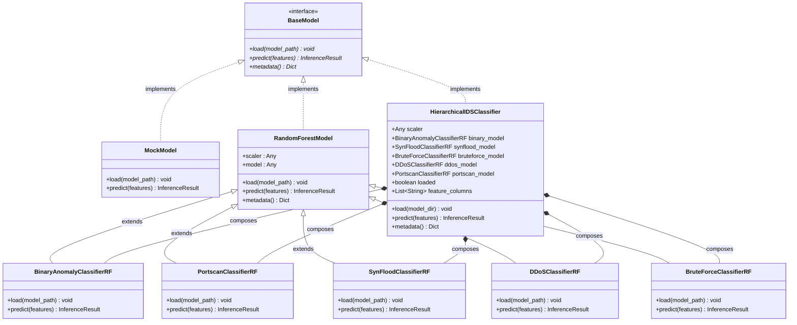

# Network Guardian IDS Dashboard - Full Stack Application

A comprehensive Network Intrusion Detection System (NIDS) dashboard built with a Django backend and a React/TypeScript/Vite frontend. It features a real-time Scapy-based packet sniffer, dynamic WiFi sniffing interface selection, and a Hierarchical Machine Learning composite classifier.

---

## 📋 Project Overview

This project consists of:
- **Backend (Django REST Framework)**: Manages packet analysis service, notification routing (console, slack), and logs/alerts storage.
- **Frontend (React + Vite + TypeScript)**: Premium UI dashboard featuring live chart series, alert feed, log tables, and real-time sniffer controls (including WiFi and custom interface selectors).
- **Hierarchical ML Engine**: A composite two-tier Random Forest pipeline with an automatic mock fallback for local development.

---

## 🏗️ Project Structure

```
network-guardian-dashboard/
├── back/                    # Django Backend
│   ├── manage.py
│   ├── requirements.txt
│   ├── db.sqlite3
│   ├── demo/                # Django project settings
│   │   ├── settings.py      # REST Framework & CORS config
│   │   ├── urls.py
│   └── myapp/               # Main application
│       ├── models.py        # TrafficLog, Alert, AuditLog
│       ├── views.py         # API endpoints
│       ├── sniffer_manager.py # Threaded sniffer control
│       ├── processing/      # IDS ML & feature extraction
│       │   ├── extractor.py # Real-time flow tracker
│       │   ├── model_wrappers.py # Hierarchical composite model
│       │   ├── model_factory.py
│       │   └── service.py   # Analysis & alert storage
│       └── tests/
│
└── front/                   # React + Vite Frontend
    ├── src/
    │   ├── components/      # UI Components (EngineStatus selector, Charts, Tables)
    │   ├── context/         # Auth and Monitoring contexts
    │   ├── routes/          # Navigation views (Alerts, Logs, Settings)
    │   └── main.tsx
    ├── package.json
    ├── vite.config.ts
    └── tsconfig.json
```

---

## 🚀 Setup & Execution Guide (Linux)

### 1. Django Backend Setup
Open your terminal and run:
```bash
# Navigate to backend folder
cd back

# Create virtual environment
python3 -m venv venv

# Activate virtual environment
source venv/bin/activate

# Install dependencies
pip install -r requirements.txt

# Run migrations
python manage.py migrate

# Start the development server
python manage.py runserver
```
The API is now running at `http://127.0.0.1:8000/`.

> [!IMPORTANT]
> **Packet Sniffing Privileges on Linux:**
> Sniffing live network packets (including WiFi sniffing) requires access to raw sockets. You must run the sniffer command or activate the virtual environment and run with root/sudo privileges:
> ```bash
> # Run sniffer on wireless interface wlan0
> sudo venv/bin/python manage.py sniff --interface wlan0
> ```

### 2. Frontend React Setup
Open a second terminal window:
```bash
# Navigate to frontend folder
cd front

# Install dependencies
npm install

# Run Vite dev server
npm run dev
```
The React dashboard is now running at `http://localhost:5173/`.

---

## 🚀 Setup & Execution Guide (Windows)

### 1. Django Backend Setup
Open PowerShell or Command Prompt:
```cmd
:: Navigate to backend folder
cd back

:: Create virtual environment
python -m venv venv

:: Activate virtual environment
:: In CMD:
venv\Scripts\activate.bat
:: In PowerShell:
.\venv\Scripts\Activate.ps1

:: Install dependencies
pip install -r requirements.txt

:: Run migrations
python manage.py migrate

:: Start the development server
python manage.py runserver
```
The API is now running at `http://127.0.0.1:8000/`.

> [!IMPORTANT]
> **Packet Sniffing Privileges on Windows:**
> To capture live traffic on Windows, you must install **Npcap** or **WinPcap** (ensure you check the box to "Install Npcap with WinPcap compatibility mode" during installation).
> Open your command prompt/PowerShell as **Administrator**, activate the virtual environment, and run:
> ```cmd
> python manage.py sniff --interface any
> ```

### 2. Frontend React Setup
Open a new terminal window:
```cmd
:: Navigate to frontend folder
cd front

:: Install dependencies
npm install

:: Run Vite dev server
npm run dev
```
The React dashboard is now running at `http://localhost:5173/`.

---

## 🛡️ Machine Learning Pipeline Architecture

The backend implements a two-tier Hierarchical Random Forest Classifier structure:



### Classification Routing Decision Block:
1. **Tier-1 (Binary Classifier)**: Filters normal vs abnormal traffic.
   - If traffic is classified as **Normal**, execution completes and the log is written as `'normal'`.
   - If traffic is classified as an **Anomaly**, execution routes to Tier-2.
2. **Tier-2 (Attack Classifiers)**: Run in parallel on the same feature vector:
   - **DDoS** (`ddos_rf.pkl`)
   - **Portscan** (`portscan_rf.pkl`)
   - **Syn Flood** (`synflood_rf.pkl`)
   - **Brute Force** (`bruteforce_rf.pkl`)
3. **Decision Rule:**
   - If **any** of the specialized Tier-2 models is positive (predicts `1`), the threat is registered with the label of the model having the highest probability.
   - If **none** of the models are positive, the threat is registered as `'unknown'` ("Unknown Threat Detected") with a description advising to *"Check network configuration."*

---

## 🔗 API Endpoints

### Traffic Logs
- `GET /api/traffic/` - Get all traffic logs
- `POST /api/traffic/` - Create a traffic log
- `GET /api/traffic/suspicious/` - Get suspicious traffic logs
- `GET /api/traffic/statistics/` - Get traffic statistics

### Alerts
- `GET /api/alerts/` - Get all alerts
- `POST /api/alerts/` - Create an alert
- `GET /api/alerts/unresolved/` - Get unresolved alerts
- `GET /api/alerts/by_severity/` - Get alerts grouped by severity
- `POST /api/alerts/{id}/resolve/` - Mark an alert as resolved

### Sniffer Control
- `GET /api/sniffer/status/` - Check if the Scapy sniffer is running
- `POST /api/sniffer/start/` - Start the sniffer engine (body: `{"interface": "wlan0"}`)
- `POST /api/sniffer/stop/` - Stop the sniffer engine

---

## 🔧 Troubleshooting

### CORS Errors
- Check that the `CORS_ALLOWED_ORIGINS` in `back/demo/settings.py` contains your frontend IP/Port (default: `http://localhost:5173`).
- Restart the Django server after making settings changes.

### DB Schema Out-of-Sync
If you face database schema errors:
```bash
# Delete DB file
rm back/db.sqlite3
# Re-run migrations
python back/manage.py migrate
```

### Packet Sniffing Errors on Windows
- Ensure **Npcap** or **WinPcap** is installed.
- Ensure PowerShell/CMD is running as **Administrator**.
- If the default interface `any` is not supported on your card, select your specific interface card index or name from the frontend dropdown list.
