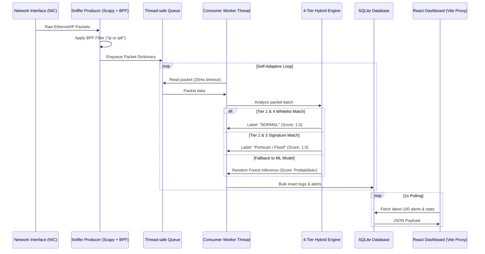

# Technical Architecture & Engineering Documentation
## Soficlef Sentinel Flow IDS (NIDS)

This document provides a detailed technical overview of the system architecture, design decisions, and optimizations implemented in the **Soficlef Sentinel Flow Network Intrusion Detection System (NIDS)**.

---

## 1. System Architecture Overview

Sentinel Flow is designed as a hybrid intrusion detection system. It combines high-speed deterministic signature checking with machine learning inference as a fallback. Below is the end-to-end data lifecycle:



---

## 2. Low-Level Packet Ingestion Subsystem

### A. Raw Packet Capture (Sniffer Producer)
The sniffing subsystem runs in a dedicated background thread (`back/myapp/sniffer_manager.py`).
* **Kernel Integration**: Captures traffic using raw sockets via Scapy’s `sniff()` engine.
* **Berkeley Packet Filters (BPF)**: Applies the filter `"ip or ip6"` at the kernel level. This discards non-IP background noise (ARP, STP, DHCP) before it reaches Python space, saving substantial CPU cycles.
* **Interface Binding**: Can bind to loopback (`lo`) for local attack simulation or physical adapters (`wlan0`, `eth0`) for live network inspection.

### B. Thread-Safe Queue & Producer-Consumer Architecture
To prevent packet drop during high-velocity floods, the sniffer implements a decoupled architecture:
1. **Producer**: The Scapy callback thread reads packets, extracts basic headers into a lightweight dictionary, and inserts them into a thread-safe `queue.Queue`.
2. **Consumer**: A separate worker thread pops packets, batch-processes them through the detection engine, and performs bulk writes to the database.

### C. Self-Adaptive Flushing Optimization
To balance database write performance with real-time alerting:
* The consumer reads from the queue with a tight **20ms timeout**.
* **Self-Adaptive Batching**: If the queue becomes empty (low traffic), the consumer immediately flushes the packet batch to the database to ensure **near-zero latency** alerts.
* If a packet flood is incoming (e.g., `hping3 --flood`), the queue fills up. The consumer automatically batches up to **50 packets** at once, executing a single SQL transaction (`bulk_create`), avoiding database write bottlenecks.

---

## 3. The 4-Tier Detection Pipeline

Every packet’s features are evaluated sequentially through a structured, hierarchical pipeline to optimize speed and classification accuracy:

```
[Packet Input]
      │
      ▼
┌───────────┐      Yes
│  Tier 1   ├───────────► [Normal] (Bypass ML)
│ Whitelist │
└─────┬─────┘
      │ No
      ▼
┌───────────┐      Yes
│  Tier 2   ├───────────► [Critical Alert] (Blacklisted protocol/flags)
│ Blacklist │
└─────┬─────┘
      │ No
      ▼
┌───────────┐      Yes
│  Tier 3   ├───────────► [Critical Alert] (DDoS, SYN Flood, Portscan)
│Rate Limit │
└─────┬─────┘
      │ No
      ▼
┌───────────┐      Yes
│  Tier 4   ├───────────► [Normal] (Bypass ML: Web browsing)
│Outbound WL│
└─────┬─────┘
      │ No
      ▼
┌───────────┐
│  Tier 5   ├───────────► Random Forest Inference (Medium/High Anomaly Alert)
│ ML Engine │
└───────────┘
```

### Tier 1: System Whitelist (O(1) Pass-Through)
Bypasses analysis for packets targeting internal management ports or multicast services (e.g., ZeroTier VPN port `9993`, local loopback APIs, SSDP).

### Tier 2: Protocol Blacklist
Checks for protocol abuse, such as malformed packets, invalid TCP flag combinations (e.g., Null scans or Xmas scans), or blacklisted source addresses.

### Tier 3: Sliding-Window Behavioral Rate-Limiter
Tracks flow state counters inside a thread-safe sliding window (2 seconds):
* **SYN Flood Detection**: If a single IP sends $\ge 20$ SYN packets within 2 seconds without completing handshakes, it is flagged as a `sync flood`.
* **Portscan Detection**: If a single IP queries $\ge 15$ unique destination ports within 2 seconds, it is flagged as a `portscan`.
* **Botnet DDoS Detection**: If coordinated IP traffic reaches $\ge 40$ concurrent packets of a single type (e.g., UDP/SYN) in 2 seconds, it is flagged as a `ddos` attack.

### Tier 4: Client Outbound Whitelist
Whitelists low-rate outbound HTTP (`80`) and HTTPS (`443`) handshakes initiated by local web clients, preventing false positives from daily web surfing.

### Tier 5: Machine Learning Inference Fallback
If a packet passes all deterministic rules, a cumulative flow record is generated, and a **Hierarchical Random Forest model** evaluates the packet.
* Low model confidence ($<0.55$): Classified as `NORMAL`.
* Moderate confidence ($0.55 - 0.75$): Alert generated with `MEDIUM` severity.
* High confidence ($0.75 - 0.90$): Alert generated with `HIGH` severity.
* High confidence ($\ge 0.90$): Alert generated with `CRITICAL` severity.

---

## 4. Backend (Django API) Optimizations

To handle high packet logging velocities, several database optimizations were implemented:

1. **Unresolved Alerts Cap**:
   The primary query fetching alerts (`AlertViewSet.unresolved()`) is ordered by `-timestamp` and limited to `100` records. This ensures that the frontend dashboard updates in real time, preventing the browser from loading massive payloads of thousands of historical logs.
2. **SQLite Connection Timeout**:
   Configured the database options inside `settings.py` with `'timeout': 20`. This extends the transaction queue wait limit to 20 seconds, eliminating `OperationalError: database is locked` errors during concurrent read/write cycles.
3. **Database Bulk Operations**:
   Logs are written using Django's `bulk_create()` to group up to 50 logs into a single database transaction.

---

## 5. Frontend (React & Vite) Architecture

### A. Real-Time Dashboard Updating
* The React dashboard relies on a `MonitoringProvider` state context (`front/src/context/monitoring-context.tsx`).
* Every **1.0 second**, the client polls the backend to fetch unresolved alerts and throughput charts. This interval provides instantaneous updates during live simulation.

### B. Mobile LAN Accessibility & Reverse Proxy
To enable access from mobile phones or external tablets connected to the same LAN (Wi-Fi):
1. **Host Wildcard**: `ALLOWED_HOSTS = ['*']` is set in Django to allow arbitrary local IP addresses.
2. **Vite Reverse Proxy**: Configured a proxy in `front/vite.config.ts` mapping `/api` requests to `http://127.0.0.1:8000`.
3. **Cookie Binding**: By having the phone target `http://<host-ip>:5173/` for both layout and API traffic, the mobile browser treats session cookies (`sessionid` and `csrftoken`) as **first-party cookies**. This bypasses mobile SameSite restrictions and iOS "Prevent Cross-Site Tracking" blocks without needing an HTTPS setup.

---

## 6. Verification and Testing Protocols

### Running the Services (LAN mode)
To start both servers so they are visible to your local network:
```bash
# Terminal 1: Backend Django API
sudo venv/bin/python manage.py runserver 0.0.0.0:8000

# Terminal 2: Frontend Vite
npm run dev -- --host
```

### Simulating Attacks for Validation
To test detection thresholds:
1. **SYN Flood Attack (hping3)**:
   ```bash
   sudo hping3 -S -p 80 --flood 127.0.0.1
   ```
   *Expected Outcome*: Flagged as `SYN Flood DDoS Attack` (Severity: CRITICAL, Color: Red).
2. **Port Scan (nmap)**:
   ```bash
   nmap -sS -F 127.0.0.1
   ```
   *Expected Outcome*: Flagged as `Portscan Intrusion Detected` (Severity: CRITICAL, Color: Red).
3. **Legitimate Traffic (curl)**:
   ```bash
   curl https://www.google.com
   ```
   *Expected Outcome*: Classed as `normal` (Secure, Color: Green).
